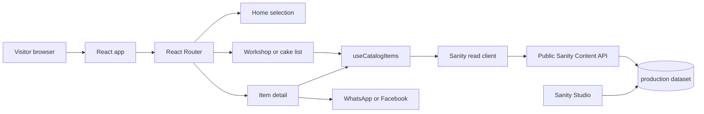

# Diana's Creaties Project Guide

This document explains how the website, Sanity CMS, and deployment setup fit together. For the shorter Sanity setup checklist, see [CMS_SETUP.md](CMS_SETUP.md).

## 1. What the project does

Diana's Creaties is a React single-page website for showing workshops and cakes. Visitors can browse catalog entries, open a detail page, and contact Diana through WhatsApp or Facebook. Catalog content is stored in Sanity and read by the website from Sanity's public Content API.

There are two separate parts to the CMS:

- **Sanity dataset:** The hosted content database. Sanity operates and hosts this; it does not need to be deployed with the website.
- **Sanity Studio:** The editor used to create, edit, publish, and delete dataset entries. It can run locally or be deployed to Sanity hosting.

The website only reads published documents. Editors sign in to the Studio to change content. No write token is included in the website.

## 2. Request and data flow



The catalog request follows this path:

1. The visitor opens `/workshops` or `/cakes`.
2. `CatalogPage` calls `useCatalogItems(category)`.
3. The hook calls `fetchCatalogItems(category)` in `src/data/catalog.ts`.
4. The Sanity client runs a GROQ query against the configured dataset, filtering by `category` and selecting published documents that have a slug.
5. The query converts Sanity fields into the `CatalogItem` shape used by the React components. The document slug becomes the route ID.
6. Each card links to `/<category>/<slug>`. `CatalogDetailPage` uses the same CMS query and selects that item by slug.

The API client uses the CDN and the `published` perspective. Published content may take a short time to appear while Sanity's CDN updates. Editing or publishing an item does not normally require rebuilding the website.

## 3. Website entry points and routes

`index.html` supplies the Dutch document language, title, description, root element, and favicon. `src/main.tsx` imports the global SCSS, creates the React root, and renders `App` inside React `StrictMode`.

`src/App.tsx` sets up React Router:

| Route | Page | Purpose |
| --- | --- | --- |
| `/` | `ComingSoon` | Brand and Workshops, Cakes and Contact choices |
| `/workshops` | `CatalogPage` | Published workshop list from Sanity |
| `/cakes` | `CatalogPage` | Published cake list from Sanity |
| `/contact` | `ContactPage` | Business and contact details, plus phone, email and social links |
| `/workshops/:id` | `CatalogDetailPage` | Workshop detail, photo, sample price/details, and contact/reservation links |
| `/cakes/:id` | `CatalogDetailPage` | Cake detail, photo, sample price/details, and contact/reservation links |
| Any other path | Redirect to `/` | Fallback for unknown routes |

The list and detail pages are shared components. Their `category` prop tells the CMS hook which category to query. The detail page uses the URL slug to find the selected record.

The home page also has expandable sections for custom cakes, filling flavours, pricing, delivery, and ordering. This shared information is currently maintained in `src/pages/ComingSoon/ComingSoon.tsx`, not in Sanity.

### Contact and reservations

The detail page builds a WhatsApp link with a URL-encoded message that includes the item's name. This is an inquiry, not a booking system: Diana confirms availability and reservations by replying. The Facebook link opens the existing group. The contact page also provides both contact links. The contact page's business details are maintained in the website source, not the CMS.

## 4. Sanity content model

The schema in `studio/schemaTypes/catalogItem.ts` defines one document type, `catalogItem`, for both cakes and workshops. The `category` field determines which overview displays the item.

| Field | Use |
| --- | --- |
| `name` | Display name |
| `slug` | Stable URL part, such as `cupcake-workshop` |
| `category` | `workshops` or `cakes` |
| `description` | Short summary shown in the list and detail page |
| `priceLabel` | Display-ready price text, such as `From EUR 30` |
| `details` | List of additional detail strings |
| `image` | Optional uploaded Sanity image; its asset URL is used when available |
| `imageUrl` | Optional external image URL used when no uploaded image is present |
| `isSample` | Marks demo records so the website can label them as examples |

If an image URL is missing or fails to load, `CatalogImage` displays a photo placeholder. Optional price and details fields are normalized by the GROQ query so incomplete records do not break the page.

The six records in `studio/seed.ndjson` are fictional samples. They are marked `isSample: true`, including their prices and descriptions. Replace or delete them before treating the catalog as real business information.

## 5. Editing content

The local Studio is available at `http://localhost:3333/studio` while `npm run cms` is running. Sign in with an account that has access to the Sanity project.

To add an item, create a **Catalog item**, fill in its name, slug, category, description, and any optional details, then publish it. Add a Sanity photo or an external image URL if desired. Published entries appear under the matching website category. To remove an item, delete its document in Studio. Unpublished drafts are not returned by the public website query.

The Studio uses the schema in `studio/schemaTypes/catalogItem.ts` and the project settings in `sanity.config.ts`. `sanity.cli.ts` configures CLI commands and loads `.env` with `dotenv/config`.

To host the Studio so an editor can access it without running the local development server, run `npx sanity deploy` after the project is configured and signed in. This deploys the editor UI; the Sanity dataset is already hosted separately. The Studio can also be built locally with `npm run cms:build`; specify a separate `--output-path` if you need to keep its build output separate from the website's `dist` directory.

## 6. Environment and access

`.env.example` lists the required local settings. Copy it to `.env` for a new checkout and replace the example project ID:

```dotenv
VITE_SANITY_PROJECT_ID=your_project_id
VITE_SANITY_DATASET=production
SANITY_STUDIO_PROJECT_ID=your_project_id
SANITY_STUDIO_DATASET=production
```

`VITE_` variables are embedded into the browser build by Vite, so the project ID and dataset must be set before building. The project ID and dataset name are public identifiers, not credentials. The local `.env` is ignored by Git. Never put a Sanity write token or password in a `VITE_` variable.

The dataset is public-read so the browser can fetch published content without a secret. Sanity CORS must allow each site origin. The local origins currently allowed are:

- `http://localhost:5173` for the Vite website
- `http://localhost:3333` for the local Studio

Add the production website origin to the Sanity project's CORS settings before deploying the site. Public reads do not need credentials enabled.

## 7. Running locally

Install dependencies once:

```powershell
npm install
```

Start the website and CMS editor in separate terminals:

```powershell
npm run dev
```

```powershell
npm run cms
```

The website is normally at `http://localhost:5173/`; the Studio is at `http://localhost:3333/studio`. The Studio requires a Sanity account with project access. On a new machine, run `npx sanity login` before importing content or deploying the Studio.

To import the sample documents into an empty `production` dataset, run this once:

```powershell
npx sanity dataset import studio/seed.ndjson production
```

The sample records have fixed IDs; do not re-import the seed after replacing the samples with real content unless you intend to overwrite the corresponding documents.

## 8. Build and deployment

`npm run build` runs the TypeScript compiler and then creates the Vite website build in `dist`. `npm run preview` serves that build locally. `npm run cms:build` builds the Studio, not the visitor-facing Vite site.

The Dockerfile has two stages:

1. A Node 20 Alpine builder installs dependencies with `npm ci` and runs the Vite build.
2. An Nginx Alpine image serves the generated `dist` directory.

Vite reads CMS settings at build time. For Docker, pass the public CMS project settings as build arguments:

```powershell
docker build --build-arg VITE_SANITY_PROJECT_ID=your_project_id --build-arg VITE_SANITY_DATASET=production -t dianas-creaties .
```

`nginx.conf` caches hashed files under `/assets/` and falls back to `index.html` for other paths so React Router routes work on direct visits and browser refreshes. The Docker image only includes the built website; the Studio is not included in that image unless its deployment is configured separately.

## 9. Styling and layout

Global reset and body styles are in `src/styles/index.scss`; color and radius variables are in `src/styles/_variables.scss`. The home page has its own CSS module. Catalog list and detail pages each have CSS modules, and `CatalogImage` shares the catalog image/fallback styles.

The catalog grid changes column count to fit available width. The detail layout becomes a single column on narrow screens. React Router `Link` components provide client-side navigation and preserve browser history; the visible back links return to the parent list or home page.

## 10. Key files

| File | Responsibility |
| --- | --- |
| `src/main.tsx` | React bootstrap and global styles |
| `src/App.tsx` | Route table |
| `src/pages/ComingSoon/ComingSoon.tsx` | Home selection cards |
| `src/pages/Contact/ContactPage.tsx` | Business and contact details |
| `src/pages/Catalog/CatalogPage.tsx` | CMS-backed category list |
| `src/pages/Catalog/CatalogDetailPage.tsx` | CMS-backed detail, contact, and reservation inquiry |
| `src/pages/Catalog/CatalogImage.tsx` | Catalog image and fallback placeholder |
| `src/data/catalog.ts` | Sanity client, GROQ query, and content mapping |
| `src/data/useCatalogItems.ts` | Loading, success, and error state for catalog requests |
| `sanity.config.ts` | Studio configuration |
| `sanity.cli.ts` | Sanity CLI project config and local environment loading |
| `studio/schemaTypes/catalogItem.ts` | Editable content schema |
| `studio/seed.ndjson` | Six importable sample records |
| `.env.example` | Local CMS environment template |
| `Dockerfile` and `nginx.conf` | Production website container and static hosting |

## 11. Operational notes

- A missing project ID, inaccessible dataset, CORS denial, or API error produces a catalog-unavailable message rather than local sample data.
- Only published Sanity documents appear on the website. Save a draft and it will remain private until published.
- The Sanity CLI currently warns that its future releases will require React 19. The app remains on React 18 for now; plan a tested React/Sanity upgrade before the CLI removes React 18 support.
- Sanity credentials belong in the Studio/CLI authentication flow. The browser website only needs public read access.